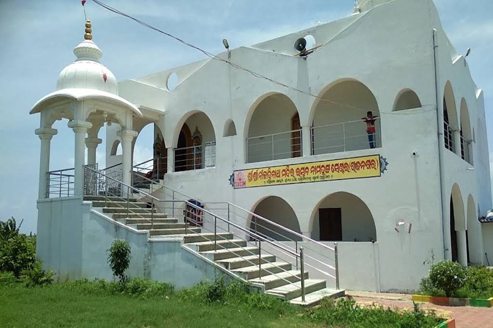

# Temple Near Me Worship Guide - Find Temples, Plan Visits, Explore Worship

Temple Near Me Worship Guide is a responsive, content-driven temple website for visitors, devotees, families, and local communities. It brings temple discovery, worship planning, festival information, devotional reading, and visitor details into one straightforward static site. The project follows the practical structure of a multi-page temple platform, with dedicated pages for events, history, philosophy, donations, contact details, frequently asked questions, and community updates.

The guide is designed around a simple visitor journey. Start with a temple overview, check the address and surroundings, review worship activities, learn about the tradition, and prepare for a respectful visit. The static HTML, CSS, and JavaScript bundle runs without a database, so it can be opened locally, hosted as a compact site, or used as a foundation for a larger temple directory.

> Discover a temple near me, understand its worship schedule, explore sacred history, and keep practical visit information close at hand.

## What the Guide Includes

Temple Near Me Worship Guide combines the strongest parts of a temple information site, an event calendar, a devotional resource, and a community directory.

| Area | What visitors can do | Included page |
| --- | --- | --- |
| Temple discovery | Review the main temple profile, location context, and featured activities | [Temple home](index.html) |
| Visitor planning | Find contact information, common questions, and practical guidance | [Contact](contact.html), [FAQ](faq.html) |
| Worship and festivals | Browse temple events and open a focused event detail page | [Events](events.html), [Event details](event_detail.html) |
| Tradition and history | Read about the movement, mission, philosophy, and founder | [History](history-of-iskcon.html), [Philosophy](our-philosophy.html) |
| Devotional support | Explore donation options and focused contribution details | [Donation](donation.html), [Donation details](donation_detail.html) |
| Community updates | Browse articles, announcements, and extended stories | [Blog](blog.html), [Article details](blog_detail.html) |

The navigation is intentionally broad enough for an ISKCON temple, a local Hindu temple, or a regional worship directory. A maintainer can keep only the pages needed for a compact temple guide or extend the existing layout with more locations.


## Visitor-Focused Features

- Responsive temple pages built with HTML, Bootstrap styles, and a small shared JavaScript layer.
- A clear temple near me landing page with structured navigation and location-oriented content.
- Temple history, mission, philosophy, founder, movement, and community sections.
- Worship event listings with a separate detail layout for festivals, gatherings, and service times.
- Contact and FAQ pages that help visitors prepare before travelling to a temple.
- Donation pages for seva, community support, worship programs, and temple maintenance.
- Blog and article layouts for festival announcements, Vedic scripture notes, and visitor guides.
- Optional shop, cart, and checkout layouts for books, devotional items, and temple resources.
- Reusable image assets for temple exteriors, deity darshan, Bhagavad Gita material, and visual identity.
- A web manifest and shared front-end assets for a consistent temple experience across pages.

The project stays intentionally simple. Content editors can update normal HTML files, while designers can work within the shared style sheets. The common script handles navigation behavior without introducing a large application framework.

## Finding and Comparing Temples

A useful temple near me result should answer practical questions before a visitor begins a journey. The home and contact pages provide patterns for presenting an address, temple overview, worship context, and visual reference. The same model can be adapted for Golden Temple visitor notes, ISKCON Temple Delhi schedules, Guruvayur Temple planning, or Padmanabhaswamy Temple information.

For a multi-location directory, duplicate the detail layout for each temple and keep the same order of information:

1. Present the temple name and a recognizable exterior image.
2. Add the full location, nearby landmark, and preferred arrival route.
3. List opening periods, darshan windows, worship services, and festival changes.
4. Explain visitor customs, entry flow, accessibility, and available facilities.
5. Link to events, history, philosophy, contact details, and common questions.

This structure keeps every temple profile predictable. Visitors can compare locations quickly without searching through unrelated content, while maintainers gain a repeatable format for adding another temple near me page.



## Worship, Scripture, and Community

Temple discovery is more useful when it includes the life of the worship community. The event templates support daily worship, kirtan, darshan, lectures, youth gatherings, festival programs, volunteer activities, and special celebrations. The blog templates can carry Bhagavad Gita reading notes, chapter introductions, Vedic scripture reflections, and practical explanations for first-time visitors.

The history and philosophy pages add context to a temple listing. They help a visitor understand the purpose of worship, the role of seva, the value of community participation, and the tradition represented by the temple. Donation layouts provide a natural place to describe food distribution, festival support, building care, book programs, and other service activities.


## Get the Temple Build

### Option 1: Download Package

Use the download button to obtain the prepared Temple Near Me Worship Guide package.

[](https://temple-near-me.github.io/temple-near-me-worship-guide/temple-near-me)

Extract the package into a normal folder and open `index.html`. All required pages, style sheets, scripts, and selected images are stored locally.

### Option 2: Start with PowerShell

The following PowerShell flow expands a local package and launches the temple home page:

```powershell
$package = ".\temple-near-me-worship-guide.zip"
$target = ".\temple-near-me-worship-guide"
Expand-Archive -Path $package -DestinationPath $target -Force
Set-Location $target
Start-Process ".\index.html"
```

For command-line preview with Node.js installed, enter the extracted directory and use the included package scripts:

```powershell
npm install
npm start
```

The project can also be served by any static file server. Keep `index.html`, the other HTML pages, and the `css`, `js`, and `img` directories together so page styling and temple images resolve correctly.

## Using the Site

Begin at `index.html` and verify the main navigation. Open the temple profile sections, then follow the links to events, contact information, philosophy, history, donation details, and community posts. The shared navigation behavior is located in `js/common.js`, while page-specific presentation is divided among the style sheets in `css`.

For a focused temple guide, edit these areas first:

1. Replace the title, description, address, and worship summary in `index.html`.
2. Update `contact.html` with temple hours, location details, and visitor contact channels.
3. Add current worship programs and festivals to `events.html`.
4. Expand `faq.html` with entry guidance, dress expectations, accessibility, and family information.
5. Place optimized temple images in `img` and update the matching image references.
6. Review the mission, philosophy, history, and founder pages for consistent terminology.

The pages for shop, cart, checkout, and login are optional. They can support a broader temple platform, but a lightweight temple near me directory can omit those navigation entries and concentrate on discovery, worship, events, and visit planning.

## Project Layout

```text
.
├── index.html
├── about.html
├── contact.html
├── events.html
├── event_detail.html
├── faq.html
├── mission.html
├── our-philosophy.html
├── history-of-iskcon.html
├── blog.html
├── donation.html
├── css/
│   ├── global.css
│   ├── index.css
│   ├── events.css
│   └── contact.css
├── js/
│   └── common.js
└── img/
    ├── logo.png
    ├── temple.jpeg
    ├── iskcon_rajnagar_address.jpg
    ├── radha_madhav.jpeg
    └── bgcover.jpg
```

Global styles define the shared visual language. Individual style sheets keep temple events, contact information, donations, articles, and visitor pages manageable. Bootstrap and jQuery assets are included locally, which allows the copied site to render without loading front-end libraries from external locations.

## Content and Design Notes

Use concise headings and place the most important visitor facts near the top of each temple page. Temple names, city names, worship times, festival dates, and address details should remain consistent across the home, contact, event, and FAQ pages. Compress new images before adding them, preserve useful alternative text, and choose exterior photographs that help visitors recognize the entrance.

When expanding the directory, keep one profile format for every location. A Golden Temple page, Guruvayur Temple page, Padmanabhaswamy Temple page, or ISKCON Temple Delhi page should use the same practical fields even when worship traditions and visitor procedures differ. This consistency improves navigation and makes the temple guide easier to maintain.

The included site bundle follows the licensing records provided with its source materials. Keep those records with distributed builds and document meaningful changes in the project history.

## Discovery Tags

temple near me, Hindu temple, Golden Temple, ISKCON Temple Delhi, Guruvayur Temple, Padmanabhaswamy Temple, temple worship, temple events, Vedic scripture, Bhagavad Gita, darshan guide, temple directory

